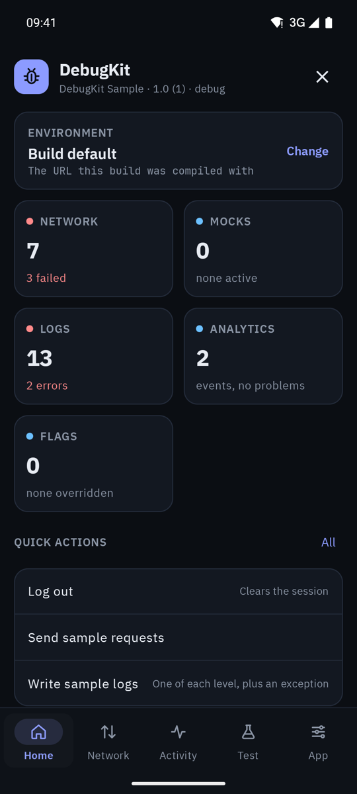
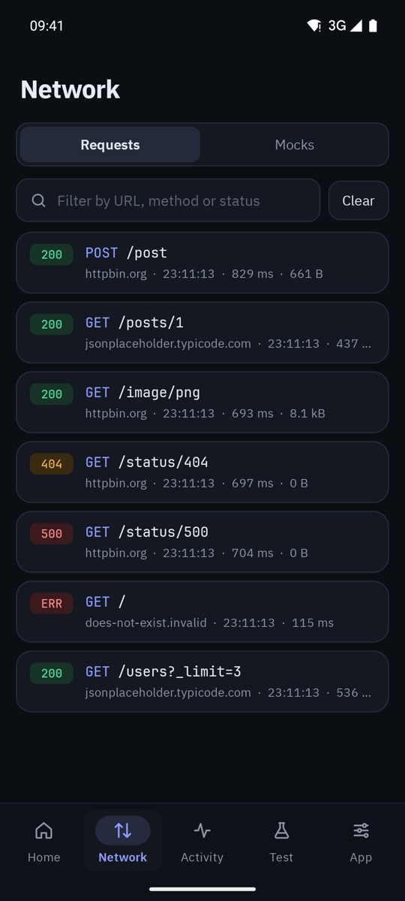
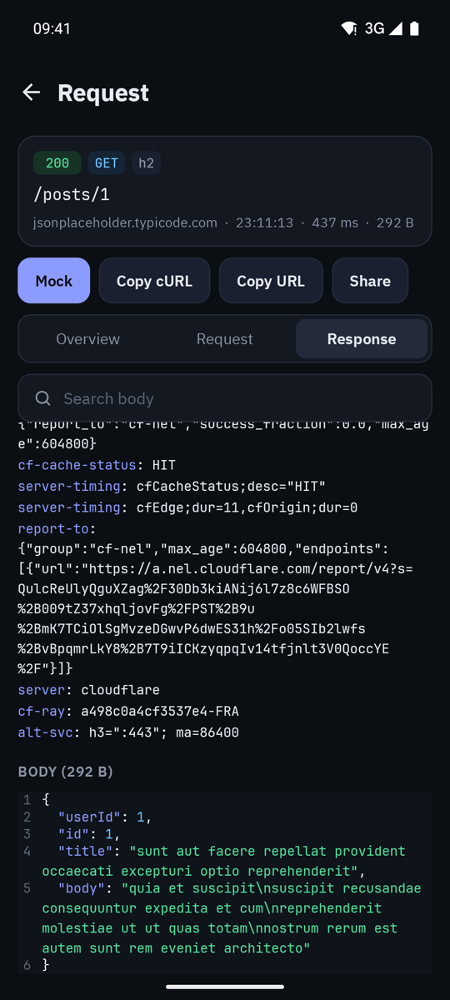
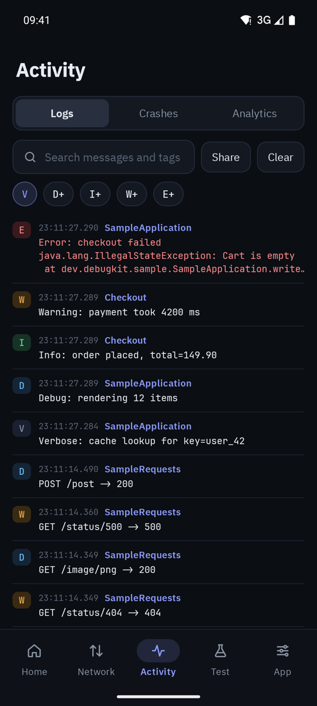
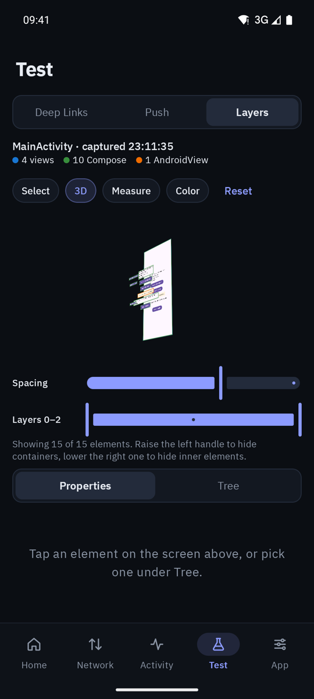
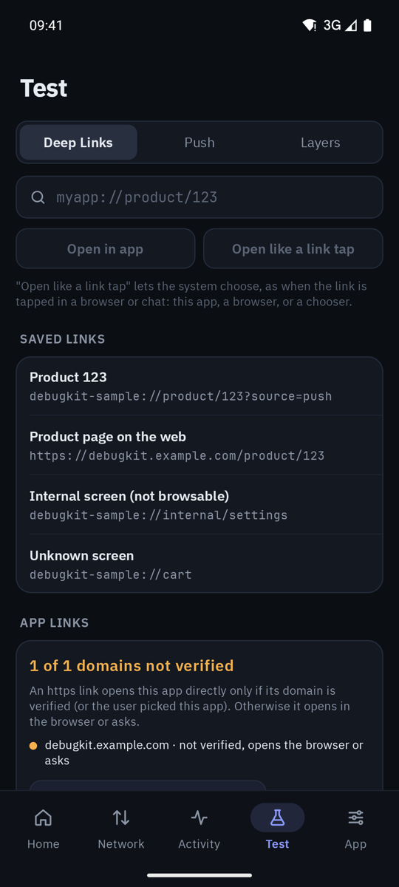
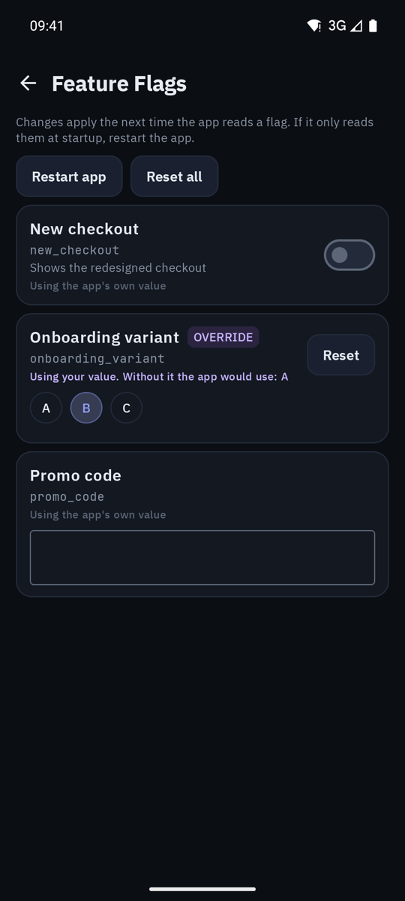

# DebugKit for Android

An in-app debugging toolkit for QA and developers. Shake the device (or call
`DebugKit.open`) while your app is running to inspect network calls, mock responses, read
logs and crashes, switch environments, override feature flags, test deep links and push
notifications, and inspect XML and Compose layouts in 3D.

<p>
  
  
  
  
</p>
<p>
  
  
  
</p>

## Features

| Tab | What it does |
|---|---|
| **Home** | Current environment, counts (failed calls, active mocks, log errors, analytics problems, flag overrides), the last crash, quick actions |
| **Network** | Every OkHttp call with headers, pretty JSON, body search, copy as cURL. Mock any response, error or delay without touching the server |
| **Activity** | Timber logs, crashes with the logs and calls that led to them, analytics events checked against Firebase's limits |
| **Test** | Open deep links and check App Links verification, send test pushes, inspect layouts (2D, 3D, measure, color picker) |
| **App** | Environment switcher, feature flag overrides, your own debug actions, app and device info |

Nothing ships to users: release builds use the `noop` module, which has the same API and
does nothing.

## Installation

`settings.gradle.kts`:

```kotlin
dependencyResolutionManagement {
    repositories {
        maven("https://jitpack.io")
    }
}
```

`app/build.gradle.kts` (pick the modules you need):

```kotlin
dependencies {
    debugImplementation("com.github.debugkit-dev.debugkit-android:core:<version>")
    debugImplementation("com.github.debugkit-dev.debugkit-android:network:<version>") // OkHttp inspector and mocks
    debugImplementation("com.github.debugkit-dev.debugkit-android:logs:<version>")    // Timber logs
    debugImplementation("com.github.debugkit-dev.debugkit-android:layers:<version>")  // layout inspector
    releaseImplementation("com.github.debugkit-dev.debugkit-android:noop:<version>")
}
```

Every build type needs either the real modules or `noop`. If QA tests a build type other than
`debug` (say `qa` or `staging`), add the modules for it too, or the app will not compile:

```kotlin
"qaImplementation"("com.github.debugkit-dev.debugkit-android:core:<version>")
```

`Application.onCreate`:

```kotlin
DebugKit.install(this)
```

That is enough to open DebugKit with a shake and get crashes, app info and the layout
inspector. The other features need one line or two in your app, listed below.

## Connecting your app

Only add what you use. Settings go in `DebugKit.install`; everything else is one line next to
code your app already has:

| Feature | Add | Where |
|---|---|---|
| Network, mocks | `DebugKitInterceptor(context)` | Where you build `OkHttpClient` |
| Logs | `Timber.plant(DebugKitTree())` | `Application.onCreate` |
| Push | `DebugKit.recordPush(...)` | `FirebaseMessagingService.onMessageReceived` |
| Analytics | `DebugKit.recordAnalyticsEvent(...)` | Your analytics wrapper, next to the real call |
| Environments | `DebugKit.environmentUrl(...)` | Where you set the Retrofit base URL |
| Feature flags | `DebugKit.flag(...)` | Where you read a flag |
| Crashes, Layers | nothing | |

Every one of these compiles in release builds too, where `noop` turns it into a no-op (the
interceptor just passes calls through), so none of it needs a `BuildConfig.DEBUG` check.

### Network inspector and mocks

Add the interceptor last, so it sees the request exactly as it is sent:

```kotlin
OkHttpClient.Builder()
    // ... your own interceptors
    .addInterceptor(DebugKitInterceptor(context))
    .build()
```

`Authorization` and cookie headers are redacted. Add more with
`DebugKitInterceptor(context) { redactHeaders = redactHeaders + "X-Api-Key" }`.

### Logs

```kotlin
Timber.plant(DebugKitTree())
```

Keep your `Timber.DebugTree()` as well if you want logs in Logcat.

### Push notifications

Record every push your app receives, first thing in your messaging service:

```kotlin
class AppMessagingService : FirebaseMessagingService() {
    override fun onMessageReceived(message: RemoteMessage) {
        DebugKit.recordPush(message.notification?.title, message.notification?.body, message.data)
        // ... your own handling
    }
}
```

To show and copy the push token, and to send test pushes through your own handler:

```kotlin
DebugKit.install(this) {
    push {
        token { FirebaseMessaging.getInstance().token.await() }
        onTestMessage { data -> pushHandler.handle(data) }    // optional
        template("Order shipped", "Your order is on its way", mapOf("type" to "order", "orderId" to "123"))
    }
}
```

DebugKit does not depend on Firebase; any push service works the same way.

### Analytics

Call it next to your real analytics call, typically in your analytics wrapper:

```kotlin
fun logEvent(name: String, params: Bundle) {
    firebaseAnalytics.logEvent(name, params)
    DebugKit.recordAnalyticsEvent(name, params)    // a Map works too; pass provider = "Adjust" for other tools
}

fun setUserProperty(name: String, value: String?) {
    firebaseAnalytics.setUserProperty(name, value)
    DebugKit.recordUserProperty(name, value)
}
```

DebugKit only displays these events; it sends nothing anywhere.

### Environments

Declare your backends, then read the base URL through DebugKit where you build Retrofit:

```kotlin
DebugKit.install(this) {
    environments {
        environment("Staging", "https://staging.api.example.com")
        environment("Dev", "https://dev.api.example.com")
    }
}

val baseUrl = DebugKit.environmentUrl(fallback = BuildConfig.API_URL)
```

A change applies after a restart, which DebugKit offers to do. Release builds always get
`fallback`.

### Feature flags

Wrap the places where you read a flag. QA can then override it:

```kotlin
DebugKit.install(this) {
    flags {
        boolean("new_checkout", "New checkout")
        choice("onboarding", "Onboarding variant", options = listOf("A", "B", "C"))
        text("promo_code", "Promo code")
    }
}

val newCheckout = DebugKit.flag("new_checkout", default = remoteConfig.getBoolean("new_checkout"))
```

Flags you read with `DebugKit.flag` show up even if you did not declare them. Release builds
always get `default`.

### Quick actions and deep links

Your own debug shortcuts, and links QA opens often:

```kotlin
DebugKit.install(this) {
    actions {
        section("Session")
        info("User ID") { session.userId }
        button("Log out") { session.logout() }
        toggle("Verbose logging", isChecked = { logger.verbose }, onCheckedChange = { logger.verbose = it })
    }
    deepLinks {
        link("Product detail", "myapp://product/123")
    }
}
```

### Crashes

Nothing to add. Crashes are saved with the logs and network calls before them, then passed on,
so Crashlytics keeps working. Call `DebugKit.install` in `Application.onCreate` (Crashlytics
starts before it). To turn it off: `captureCrashes = false`.

### Layers

Nothing to add. For readable names on Compose screens, give important composables a
`Modifier.testTag(...)`.

### Opening DebugKit

Shake to open is on by default (`shakeToOpen = false` to turn it off). To open it from your
own debug menu or a button:

```kotlin
DebugKit.open(context)
```

## Your own screens

Add a page from debug-only code (`src/debug`), since `noop` has no plugin API:

```kotlin
DebugKit.registerPlugin(object : DebugPlugin {
    override val id = "my-app.session"
    override val title = "Session"
    override val section = DebugSection.App

    @Composable
    override fun Content() { /* your Compose UI */ }
})
```

`dev.debugkit.ui` has DebugKit's own cards, pills, chips and colors, so your page can match.

## Developing against a local copy

In your app's `settings.gradle.kts`:

```kotlin
val debugKit = file("../debugkit-android")
if (debugKit.exists()) includeBuild(debugKit)
```

## License

Apache 2.0. See [LICENSE](LICENSE). Bundled fonts: IBM Plex Sans and JetBrains Mono, under the
SIL Open Font License (see [third_party_licenses](third_party_licenses)).
